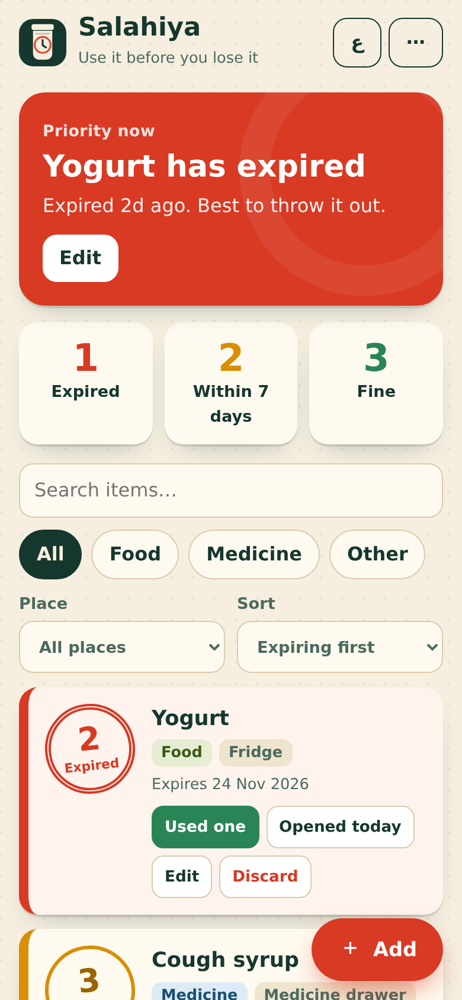
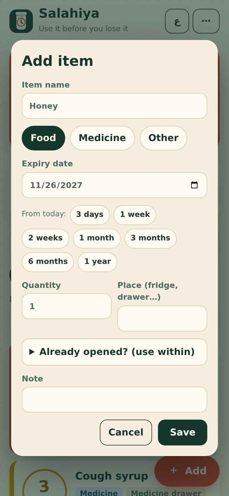
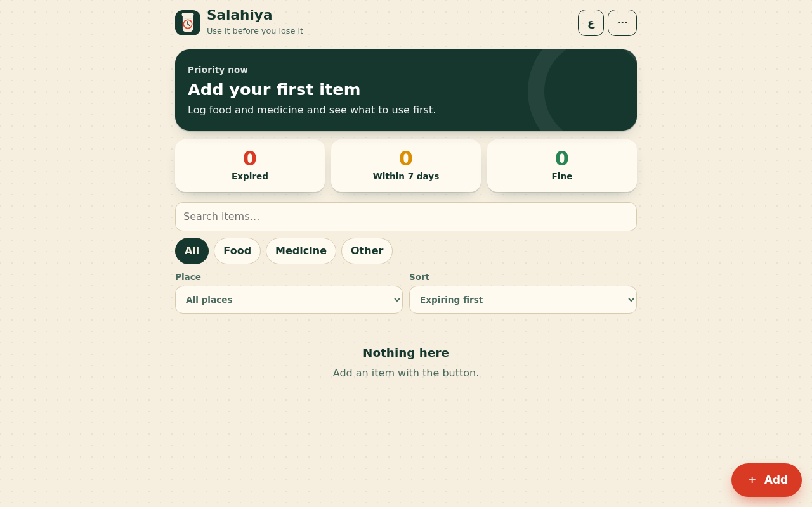
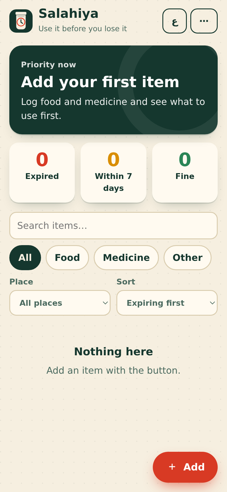

<p align="center"></p>
<h1 align="center">Salahiya · صلاحية</h1>
<p align="center"><b>Know what expires before it spoils.</b><br>An expiry-date tracker for the food and medicine in your home. Arabic and English, works offline, no account.</p>
<p align="center"><a href="https://yousefkhames.github.io/salahiya/"><b>Open the live demo</b></a></p>

<p align="center">



</p>

## Screenshots

Captured from the live site (https://yousefkhames.github.io/salahiya/).

<p>
  
  
</p>

## Why
Half-used syrups, yogurt at the back of the fridge, eye drops opened months ago. Salahiya shows one answer: what to use first, what is already expired, and what is close.

## Features
- **Priority card**: the single item you should deal with now.
- **Countdown stamps** on every item, sorted by what expires first. Expired items are marked clearly.
- **Opened shelf life**: set "use within N days" after opening. The app uses the earlier of the printed date and the opened-plus-N date.
- **Quick presets** (3 days to 1 year) so you can add an item in a few taps.
- Filters by status, category (food, medicine, other), place and search; sort by expiry, name or newest.
- "Used one" lowers quantity, "Discard" removes it; every change has **Undo**.
- A simple tally of items you used in time versus discarded.
- Warning window you choose (3, 7, 14 or 30 days).
- Export JSON and CSV (Excel-friendly), import JSON with row validation.
- Arabic (RTL, Arabic digits) and English (LTR), mobile first, installable as a home-screen app, opens offline after the first visit.

## Tech
Plain HTML, CSS and JavaScript. No framework, no build step, no server. Data in `localStorage`. Core date and filter logic is in `logic.js` (pure functions, unit tested). A tiny service worker caches the files.

## Run and test
```bash
python3 -m http.server 8080      # then open http://localhost:8080
npm install && npm test          # 13 unit tests + a real Chrome click-through (needs Google Chrome at /usr/bin/google-chrome)
BASE=https://yousefkhames.github.io/salahiya/ node tests/e2e.js   # same click-through against the live site
```

## Honest limits
- Data lives **only in the browser you use**. Clearing site data erases it, and it does not sync between phone and laptop. Use export for backups.
- GitHub Pages is a demo host. Treat this as a demo, not a hosted service.
- Browser alerts appear **only when you open the app**. A static site cannot push notifications in the background.
- No barcode scanning. Dates are typed or picked.
- It is a reminder tool. Always check the actual package before eating or taking medicine.

## License
MIT, see [LICENSE](LICENSE).


## Demo / portfolio project

Static GitHub Pages site. Data stays in your browser. Sample data is fictional and results are not professional, legal, medical or financial advice.

By Yousef Khames · من تطوير يوسف خميس
